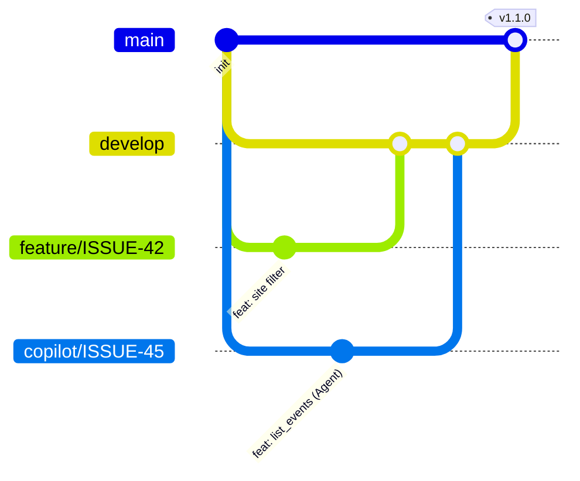

# GitHub Copilot Business 팀 개발 업무 방법서

> **기준 프로젝트**: xv3_mcp (XV3 NMS MCP Server)  
> **대상 독자**: 개발자 (실무 중심)  
> **목적**: GitHub Copilot Business를 활용하여 신규·협업 프로젝트를 효율적으로 진행하는 실전 방법

---

## 목차

1. [핵심 개념 — 무엇이 달라지는가](#1-핵심-개념--무엇이-달라지는가)
2. [환경 구성 — 신규 리포 셋업 체크리스트](#2-환경-구성--신규-리포-셋업-체크리스트)
3. [Copilot Instructions 작성법](#3-copilot-instructions-작성법)
4. [일상 개발 워크플로우](#4-일상-개발-워크플로우)
5. [Copilot Coding Agent 위임 가이드](#5-copilot-coding-agent-위임-가이드)
6. [AI 생성 코드 리뷰 방법](#6-ai-생성-코드-리뷰-방법)
7. [브랜치 전략 및 PR 워크플로우](#7-브랜치-전략-및-pr-워크플로우)
8. [이슈 템플릿 운영](#8-이슈-템플릿-운영)
9. [GitHub Actions 자동화](#9-github-actions-자동화)
10. [도입 로드맵 (단계별 체크리스트)](#10-도입-로드맵-단계별-체크리스트)
11. [생산성 측정 및 회고](#11-생산성-측정-및-회고)
12. [참고 자료](#12-참고-자료)

---

## 1. 핵심 개념 — 무엇이 달라지는가

### 1.1 개발자 역할의 변화

기존 방식은 개발자가 구현부터 문서화까지 혼자 담당했다면, Copilot Business 도입 후에는 **"AI에게 무엇을 시킬지 결정하고 결과를 검증"**하는 역할로 무게중심이 이동한다.

```
【기존 방식】
개발자 → 코드 작성 → 리뷰 → 머지

【Copilot Business 방식】
개발자 → 명확한 스펙 정의 → Copilot Agent 위임 → 결과 검증·수정 → 머지
```

| 개발 활동 | 기존 | Copilot Business |
|-----------|------|-----------------|
| 반복적인 CRUD 구현 | 직접 작성 (수시간) | Agent 위임 (수분~수십분) |
| 코드 자동완성 | 없음 / 검색 | IDE 인라인 제안 |
| PR 설명 작성 | 직접 작성 | Copilot 자동 생성 후 수정 |
| 1차 코드 리뷰 | 동료가 전담 | Copilot Review 후 사람이 보완 |
| 문서화 | 개발 후 별도 작업 | 코드와 동시에 자동 초안 |
| 구조 파악 (온보딩) | 코드 직접 독해 | Copilot Chat 질의응답 |

### 1.2 Copilot 도구 선택 기준

| 상황 | 사용할 도구 |
|------|------------|
| 코딩 중 다음 줄이 막힐 때 | **IDE 자동완성** (Tab) |
| 함수 로직을 설명받거나 리팩토링할 때 | **Copilot Chat** (IDE) |
| 터미널에서 명령어를 모르거나 리포를 탐색할 때 | **Copilot CLI** (`gh copilot`) |
| PR 생성 후 설명·리뷰가 필요할 때 | **Copilot for PR** (GitHub 웹) |
| 명확한 스펙의 이슈를 빠르게 구현해야 할 때 | **Copilot Coding Agent** (이슈 할당) |

---

## 2. 환경 구성 — 신규 리포 셋업 체크리스트

신규 프로젝트를 시작할 때 아래 파일 구조를 갖추면 Copilot이 프로젝트 컨텍스트를 이해하고 더 정확한 코드를 생성한다.

### 2.1 필수 파일 목록

```
프로젝트루트/
├── .github/
│   ├── copilot-instructions.md        # ① Copilot 전용 컨텍스트 파일 (핵심)
│   ├── PULL_REQUEST_TEMPLATE.md       # ② PR 작성 가이드
│   └── ISSUE_TEMPLATE/
│       ├── feature_request.md         # ③ 기능 요청 템플릿
│       ├── bug_report.md              # ④ 버그 리포트 템플릿
│       └── copilot_task.md            # ⑤ Agent 위임 전용 템플릿
├── docs/
│   └── copilot-team-guide.md          # ⑥ 이 파일 (팀 방법서)
├── CLAUDE.md                          # ⑦ AI 클라이언트용 프로젝트 설명 (선택)
└── README.md                          # ⑧ 일반 설명서
```

> **xv3_mcp 현재 상태**: ①②③④⑤⑥⑦⑧ 모두 구비 완료 ✅

### 2.2 셋업 우선순위

1. **`copilot-instructions.md` 먼저** — 이 파일 없이 다른 파일을 추가해도 Copilot 품질이 낮다.
2. **이슈 템플릿 다음** — Agent 위임 전에 템플릿이 있어야 일관된 스펙을 유지할 수 있다.
3. **PR 템플릿 마지막** — 협업 인원이 늘어날 때 추가해도 늦지 않다.

### 2.3 GitHub Actions 자동화 파일 (권장)

```
.github/workflows/
├── ci.yml                  # Node.js syntax check (Node 18/20/22 matrix)
├── codeql.yml              # CodeQL 보안 스캔 (매주 + PR)
├── dependency-review.yml   # 의존성 취약점 자동 검사 (PR 시)
└── release.yml             # 태그 푸시 시 GitHub Release 자동 생성
```

---

## 3. Copilot Instructions 작성법

`.github/copilot-instructions.md`는 팀의 **AI와의 계약서**다. Copilot이 이 파일을 읽고 프로젝트 컨텍스트를 이해한다.

### 3.1 반드시 포함해야 할 항목

```markdown
## 아키텍처 개요
- 진입점, 주요 모듈, 역할 분리 구조 설명

## 코딩 컨벤션 (절대 규칙)
- 응답 형식: ok()/err() 헬퍼 사용
- SQL: 항상 parameterized query (? 바인딩)
- 보안: 민감 필드는 SELECT에서 제외

## 도메인 지식 (AI가 모를 수 있는 것)
- 상태 코드 매핑 (예: DOWN=0 vs DOWN=2)
- 테이블 간 관계, 특수 쿼리 패턴

## 자주 하는 실수 (Gotchas)
- 놓치기 쉬운 엣지 케이스 명시
```

### 3.2 xv3_mcp 실제 적용 예시

이 프로젝트의 `.github/copilot-instructions.md`에는 다음이 포함되어 있다:

```markdown
# 핵심 컨벤션
1. 모든 응답은 ok()/err() 헬퍼 사용
2. 배열 응답: { count: N, items: [...] }
3. 쓰기 함수: create_id/modify_id = 'mcp'
4. device.status: UP=1 / DOWN=0
   interface.oper_status: UP=1 / DOWN=2  ← DOWN 값이 다름!
5. ro_community, 패스워드 필드 SELECT 제외
6. 모든 SQL: parameterized query
7. 도구 추가 시 index.js + TOOLS.md 동시 업데이트
```

### 3.3 Instructions 관리 원칙

- **변경 시 PR 필수** — 팀 전체에 영향을 주므로 단독 커밋 금지
- **새 패턴 발견 즉시 추가** — "이런 거 있었어?" 방지
- **분기 1회 팀 전체 리뷰** — 더 이상 유효하지 않은 내용 정리

---

## 4. 일상 개발 워크플로우

### 4.1 기능 추가 시 의사결정 흐름

```
새 기능 이슈 등록
        │
        ▼
스펙이 명확하고 패턴이 기존과 유사한가?
        │
   YES ─┤         NO
        │          └─→ 개발자가 직접 설계 후 구현
        ▼
Copilot Coding Agent에 이슈 할당
        │
        ▼
Agent가 PR 자동 생성 (수분~수십분)
        │
        ▼
AI 생성 코드 검증 체크리스트로 리뷰
        │
        ▼
수정 요청 or 승인 후 머지
```

### 4.2 IDE에서 Copilot Chat 효과적으로 사용하기

**좋은 프롬프트 패턴:**

```
# 기존 패턴을 따라 새 함수 추가
"tools/get.js의 listDevices() 패턴을 그대로 따라서
 xv3_issue.issue_log 테이블을 조회하는 listEvents() 함수를 만들어줘.
 필터: device_id, severity, start_date, end_date (모두 optional)"

# 코드 설명 요청
"issueHelper.js의 resolveIssueTables() 함수가 하는 일을 설명해줘"

# 버그 원인 분석
"LEFT JOIN에서 WHERE 절 대신 ON 절에 필터를 넣어야 하는 이유를 
 이 코드 컨텍스트에서 설명해줘"
```

**피해야 할 프롬프트:**
```
# 너무 추상적 (Hallucination 유발)
"이슈 조회 기능 추가해줘"

# 컨텍스트 없음 (엉뚱한 코드 생성)
"이벤트 로그 조회 API 만들어줘"
```

### 4.3 Copilot CLI 활용 패턴

```bash
# 코드 리뷰 요청
gh copilot suggest "현재 변경사항에서 SQL Injection 위험 요소 확인해줘"

# 커밋 메시지 생성
gh copilot suggest "현재 스테이징된 변경사항에 맞는 커밋 메시지 작성해줘"

# 명령어 생성
gh copilot suggest "MariaDB에서 특정 테이블의 컬럼 목록 확인하는 명령어"
```

---

## 5. Copilot Coding Agent 위임 가이드

### 5.1 Agent에게 위임하기 좋은 작업

| 위임 적합 ✅ | 위임 부적합 ❌ |
|------------|-------------|
| 기존 패턴과 동일한 CRUD 추가 | 새로운 아키텍처 설계 |
| 단순 값 변경·상수 수정 | 외부 서비스 연동 설계 |
| 반복적인 코드 리팩토링 | 보안 정책 결정 |
| 기계적인 마이그레이션 | 트랜잭션·동시성 처리 설계 |
| 명확한 스펙의 유틸 함수 | 비즈니스 로직이 복잡한 기능 |

### 5.2 Agent가 성공하는 이슈 작성법

Agent는 이슈를 읽고 코드를 생성한다. **이슈 품질 = 코드 품질**이다.

**나쁜 이슈 예시 (Agent가 추측해야 함):**
```
제목: 이벤트 조회 기능 추가
내용: xv3_issue에서 이벤트 조회하는 기능 만들어주세요
```

**좋은 이슈 예시 (`.github/ISSUE_TEMPLATE/copilot_task.md` 활용):**
```markdown
## 목표
xv3_issue.issue_log에서 이벤트를 조회하는 MCP 도구 `list_events` 추가

## 구현 위치
- `tools/issue.js` (신규 파일)
- `index.js` (도구 등록)
- `TOOLS.md` (문서 추가)

## 함수 시그니처
async function listEvents({ device_id, severity, issue_type,
  start_date, end_date, active_only, limit = 100 } = {}) { ... }

## SQL 설계
SELECT il.*, di.device_name, di.device_ip
FROM xv3_issue.issue_log il
LEFT JOIN xv3.device_info di ON il.device_id = di.device_id
WHERE 1=1
  AND (device_id IS NULL OR il.device_id = ?)   -- optional
  AND (severity  IS NULL OR il.severity  = ?)   -- optional
LIMIT ?

## 따라야 할 기존 패턴
tools/get.js의 listDevices() 구조와 동일하게 작성

## 완료 조건
- [ ] tools/issue.js 파일 생성 및 listEvents() 구현
- [ ] index.js에 'list_events' 도구 등록 (Zod 스키마 포함)
- [ ] TOOLS.md에 도구 항목 추가
- [ ] 기존 도구 동작에 영향 없음 확인
```

### 5.3 Agent 위임 절차 (Step-by-Step)

```
Step 1. 이슈 생성
  - 템플릿: .github/ISSUE_TEMPLATE/copilot_task.md 사용
  - 레이블: copilot-task 추가
  - 제목 접두사: "copilot: " 사용 (예: "copilot: list_events 도구 추가")

Step 2. Agent 할당
  - 이슈 우측 사이드바 → Assignees → @Copilot 선택
  - 또는 이슈 댓글: "@github-copilot implement this"

Step 3. PR 생성 확인 (수분~수십분 소요)
  - Copilot이 브랜치 생성 및 PR 자동 오픈
  - 브랜치명 패턴: copilot/ISSUE-{번호}-{기능명}

Step 4. AI 코드 리뷰 (6장 참조)
  - 정확성·보안·패턴 준수 검증
  - 수정 필요 시 PR 코멘트로 피드백

Step 5. 머지
  - AI 생성 PR은 리뷰어 2명 필수
```

---

## 6. AI 생성 코드 리뷰 방법

AI가 생성한 코드는 문법적으로 완벽해 보여도 **프로젝트별 도메인 지식**이 빠질 수 있다.  
리뷰어는 문법·스타일이 아닌 **정확성·보안·패턴 준수**에 집중한다.

### 6.1 리뷰 우선순위

```
1순위 — 보안: SQL Injection, 민감 정보 노출
2순위 — 정확성: 존재하는 테이블/컬럼 참조, 상태 코드 값
3순위 — 패턴 준수: ok()/err() 헬퍼, parameterized query
4순위 — 문서 동기화: TOOLS.md 함께 업데이트 여부
```

### 6.2 AI 생성 코드 전용 리뷰 체크리스트

> PR 설명의 "AI 생성 코드 검증" 섹션과 동일. 리뷰어가 각 항목을 직접 코드에서 확인한다.

**정확성 (Hallucination 방지)**
- [ ] 참조하는 테이블명이 실제 DB에 존재하는가?
- [ ] 참조하는 컬럼명이 실제 테이블에 존재하는가?
- [ ] JOIN 조건이 의도한 관계를 정확히 표현하는가?
- [ ] 상태 코드 값이 맞는가? (`device.status` DOWN=**0**, `oper_status` DOWN=**2**)
- [ ] NULL 처리가 실제 데이터 특성에 맞게 되어 있는가?

**보안**
- [ ] 모든 사용자 입력이 `?` parameterized query로 처리되는가?
- [ ] `ro_community`, 패스워드 필드가 SELECT에서 제외되었는가?
- [ ] 동적 테이블명·컬럼명 사용 시 화이트리스트 검증이 있는가?

**패턴 준수**
- [ ] 응답이 `ok()` / `err()` 헬퍼를 통해 반환되는가?
- [ ] 배열 응답이 `{ count: N, items: [...] }` 형태인가?
- [ ] 쓰기 함수에서 `create_id` / `modify_id`가 `'mcp'`로 설정되었는가?
- [ ] 에러 처리 방식이 기존 도구들과 동일한가?

**문서 동기화**
- [ ] `TOOLS.md`에 새 도구 항목이 추가되었는가?
- [ ] `index.js`에 Zod 스키마가 올바르게 등록되었는가?

### 6.3 Copilot PR Review 활용 순서

```
1. PR 생성 → GitHub 웹에서 [Copilot] → [Review] 클릭
   → Copilot이 문법·기본 보안 패턴 자동 1차 리뷰

2. 사람 리뷰어는 Copilot 리뷰 결과 확인 후
   → 위 6.2 체크리스트로 도메인 특화 항목 집중 검토

3. 수정 요청 시 PR 코멘트에 구체적인 피드백 기재
   → Copilot Agent가 댓글 읽고 수정 커밋 가능
```

---

## 7. 브랜치 전략 및 PR 워크플로우

### 7.1 브랜치 명명 규칙

```
feature/ISSUE-{번호}-{기능명}      # 개발자 직접 구현
copilot/ISSUE-{번호}-{기능명}      # Copilot Agent 자동 생성
fix/ISSUE-{번호}-{버그명}          # 버그 수정
refactor/{모듈명}-{내용}           # 리팩토링
```

**예시:**
```
feature/ISSUE-42-add-site-filter
copilot/ISSUE-45-list-events
fix/ISSUE-48-interface-status-down-value
```

### 7.2 브랜치 구조



### 7.3 머지 기준

| 브랜치 출처 | 필수 승인 수 | 추가 요건 |
|------------|------------|---------|
| 개발자 직접 작성 | 1명 | 일반 리뷰 |
| **Copilot Agent 생성** | **2명** | 6.2 체크리스트 전체 확인 |
| 핵심 모듈 변경 (`index.js`, `db.js`) | **2명** | 아키텍처 검토 |

### 7.4 PR 생성 시 필수 절차

```
1. PR 생성 → Copilot PR Summary 버튼 클릭
   → 자동 생성된 설명을 Description에 붙여넣기

2. PR 템플릿의 "구현 방식" 체크박스 중 해당 항목 선택
   (직접 구현 / Copilot 제안 수용 / Agent 자동 생성 등)

3. "리뷰 포인트" 섹션에 집중해야 할 부분 명시

4. Agent PR인 경우 "AI 생성 코드 검증" 체크리스트 항목 직접 확인 후 체크
```

---

## 8. 이슈 템플릿 운영

이 프로젝트는 세 가지 이슈 템플릿을 제공한다.

### 8.1 템플릿 선택 기준

| 상황 | 템플릿 |
|------|--------|
| 새 도구/기능 추가 | `feature_request.md` |
| 버그 신고 | `bug_report.md` |
| **Copilot Agent에 위임할 구현** | `copilot_task.md` ← 가장 중요 |

### 8.2 `copilot_task.md` 작성 핵심 원칙

Agent 위임 이슈는 **"이 이슈만 읽어도 구현할 수 있어야 한다"**는 기준으로 작성한다.

| 항목 | 설명 |
|------|------|
| **목표** | 한 문장으로 무엇을 구현하는지 |
| **구현 위치** | 변경할 파일 목록 (추측 불필요하게) |
| **함수 시그니처** | 파라미터명·타입·기본값 명시 |
| **SQL / 로직** | 사용할 테이블, JOIN, WHERE 조건 |
| **따라야 할 패턴** | 참조할 기존 함수명 명시 |
| **완료 조건** | 체크리스트 형태로 명확히 |

---

## 9. GitHub Actions 자동화

### 9.1 현재 설정된 워크플로우

| 파일 | 트리거 | 역할 |
|------|--------|------|
| `ci.yml` | push/PR → main | Node.js 18/20/22 문법 검사 |
| `codeql.yml` | push + 매주 월요일 | JavaScript 보안 취약점 스캔 |
| `dependency-review.yml` | PR → main | 의존성 패키지 취약점 검사 |
| `release.yml` | 태그 `v*.*.*` 푸시 | GitHub Release 자동 생성 |

### 9.2 신규 프로젝트에 복사해서 쓰는 방법

```bash
# xv3_mcp의 .github 폴더를 신규 프로젝트에 복사
cp -r xv3_mcp/.github 신규프로젝트/

# 언어/프레임워크에 맞게 수정 필요한 파일
# - ci.yml: node --check → 해당 언어 빌드/린트 명령으로 교체
# - codeql.yml: languages: javascript → 해당 언어로 교체
# - copilot-instructions.md: 프로젝트 컨텍스트 전면 재작성
```

### 9.3 릴리즈 절차

```bash
# 버전 태그 생성 → release.yml 자동 실행
git tag v1.1.0
git push origin v1.1.0

# 결과: GitHub Releases 페이지에 자동으로 릴리즈 노트 생성
# - 이전 태그 이후의 커밋 목록 자동 포함
# - alpha/beta 태그는 prerelease로 자동 마킹
```

---

## 10. 도입 로드맵 (단계별 체크리스트)

### Phase 1 — 기반 구축 (1~2주)

**목표**: Copilot이 프로젝트를 이해하는 환경 완성

```
□ 팀원 전원 GitHub Copilot Business 라이선스 활성화 확인
□ VS Code 또는 JetBrains Copilot 플러그인 설치
□ .github/copilot-instructions.md 팀 리뷰 및 보완
   → 프로젝트 아키텍처, 컨벤션, 도메인 gotcha 포함 여부 확인
□ .github/ISSUE_TEMPLATE/copilot_task.md 템플릿 내용 팀 합의
□ .github/PULL_REQUEST_TEMPLATE.md 팀 합의
□ GitHub Actions 워크플로우 적용 및 동작 확인
□ 팀 내 Copilot 기본 사용법 세션 진행 (2시간)
   → IDE 자동완성, Copilot Chat, PR 요약 실습
```

### Phase 2 — 협업 습관 형성 (3~4주)

**목표**: Copilot 사용이 자연스러운 개발 루틴 정착

```
□ 모든 새 기능을 Copilot Chat과 페어 프로그래밍으로 진행
□ PR 생성 시 Copilot PR 요약 필수 사용 (Description 첨부)
□ 코드 리뷰 시 Copilot Review 1차 실행 → 사람이 보완
□ 주 1회 "Copilot으로 해결한 것 공유" 세션 (15분 스탠드업)
□ 잘 작성된 이슈 vs 부실한 이슈 사례 팀 공유
□ Copilot CLI 터미널 작업에 활용 시작
```

### Phase 3 — Agent 위임 도입 (5~8주)

**목표**: 명확한 스펙의 반복 작업은 Copilot Coding Agent에 위임

```
□ 첫 번째 Agent 위임 이슈 생성 및 실행 (간단한 것부터)
□ Agent PR 리뷰 경험 팀 공유 (성공·실패 사례 모두)
□ "copilot-task" 레이블 및 이슈 필터 운영
□ Agent 위임 가능/불가능 판단 기준 팀 합의
□ Agent 생성 PR 리뷰어 2명 프로세스 정착
□ copilot-instructions.md 첫 번째 개선 (Agent 사용 후 발견된 gap 반영)
```

### Phase 4 — 최적화 및 확산 (9~12주)

**목표**: 팀만의 Copilot 활용 패턴 확립 및 측정

```
□ 생산성 지표 측정 (11장 참조)
□ 팀 내 Best Practice 문서화 (이 파일에 추가)
□ Agent 위임 비율 목표 설정 (전체 PR의 30% 이상 권장)
□ Copilot Instructions 고도화
□ 다른 팀/프로젝트에 경험 공유 및 이 가이드 배포
```

---

## 11. 생산성 측정 및 회고

### 11.1 추적 지표

| 지표 | 측정 방법 | 목표 |
|------|-----------|------|
| Agent 위임 비율 | `copilot/` 브랜치 수 / 전체 PR 수 | 30% 이상 |
| PR 리뷰 사이클 | PR 생성~머지 평균 일수 | 20% 단축 |
| 첫 PR까지 소요일 (온보딩) | 신규 팀원 추적 | 50% 단축 |
| 핫픽스 PR 수 | AI 생성 코드 버그 추적 | 현상 유지 이하 |

### 11.2 월간 회고 질문 (15분)

```
1. 이번 달 Copilot으로 가장 많이 절약된 작업은?
2. Copilot이 잘못된 코드(Hallucination)를 만든 사례가 있었는가?
   → 있다면: copilot-instructions.md에 관련 Gotcha 추가
3. Agent에 위임했을 때 성공한 이슈의 공통점은?
4. Agent가 실패한 이슈의 원인은? (스펙 부족 / 복잡도 / 컨텍스트 부재)
5. 다음 달 새로 시도할 Copilot 활용 방법은?
```

---

## 12. 참고 자료

### 공식 문서
- [GitHub Copilot 공식 문서](https://docs.github.com/copilot)
- [Copilot Coding Agent 사용법](https://docs.github.com/en/copilot/using-github-copilot/using-copilot-coding-agent)
- [Copilot Custom Instructions 설정](https://docs.github.com/en/copilot/customizing-copilot/adding-custom-instructions-for-github-copilot)
- [Copilot for Pull Requests](https://docs.github.com/en/copilot/using-github-copilot/creating-a-pull-request-summary-with-github-copilot)

### 이 프로젝트 내 참조 파일
| 파일 | 용도 |
|------|------|
| `.github/copilot-instructions.md` | Copilot 컨텍스트 파일 (컨벤션·아키텍처) |
| `.github/ISSUE_TEMPLATE/copilot_task.md` | Agent 위임 이슈 템플릿 |
| `.github/PULL_REQUEST_TEMPLATE.md` | PR 작성·검증 가이드 |
| `CLAUDE.md` | AI 클라이언트용 상세 아키텍처 설명 |
| `TOOLS.md` | 전체 44개 도구 레퍼런스 |
| `README.md` | 설치·실행 가이드 |

---

*이 문서는 팀의 경험이 쌓이면서 지속적으로 업데이트되어야 합니다.*  
*최초 작성: 2026-05-13 | 마지막 업데이트: 2026-06-02*
